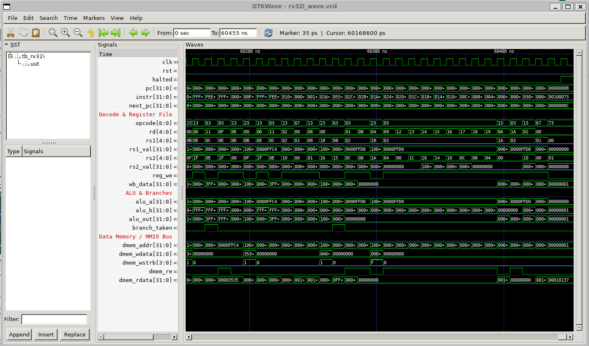
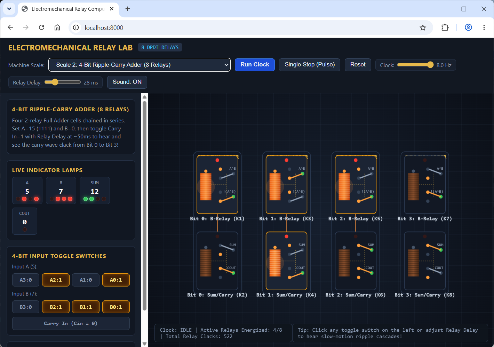

# Minimal RISC-V (RV32I) CPU & Electromechanical Relay Computer Lab

An instructive hardware architecture repository exploring digital computation from two angles:
1. **Silicon / FPGA RTL (`rv32i_cpu.v`):** A complete, synthesizable single-cycle **32-bit RISC-V (`RV32I`)** processor in ~200 lines of Verilog that compiles and runs bare-metal C code using open-source tools (`iverilog`, `gcc-riscv64-unknown-elf`, and `gtkwave`).
2. **Electromechanical Relay Lab (`relay-sim/`):** A browser-based, physics-driven **DPDT Relay Computer Simulator** (scaling from a 2-relay 1-bit full adder up to 35-, 64-, and 128-relay programmable computers) with procedural Web Audio relay clacking and realistic contact propagation delays.

---

## 1. Single-Cycle RV32I Processor in Verilog

The Verilog core ([`rv32i_cpu.v`](rv32i_cpu.v)) implements all 40 instructions of the unprivileged RV32I base integer instruction set (`LUI`, `AUIPC`, `JAL`, `JALR`, conditional branches, byte/halfword/word loads and stores, register-immediate and register-register ALU ops, `FENCE`, and `ECALL`/`EBREAK`).



### Quick Start (RISC-V Simulation)

Install the open-source toolchain (Ubuntu/Debian):
```sh
sudo apt install iverilog gtkwave gcc-riscv64-unknown-elf binutils-riscv64-unknown-elf
```

Compile the bare-metal C firmware ([`firmware.c`](firmware.c) + [`start.S`](start.S)) and run it on the Verilog CPU:
```sh
make run     # Compile C firmware and run simulation (prints via virtual UART at 0x10000000)
make trace   # Run with cycle-by-cycle PC, instruction, and register trace
make wave    # Open the recorded waveform (rv32i_wave.vcd) in GTKWave
```

See [`RISCV_CHEATSHEET.md`](RISCV_CHEATSHEET.md) for a crash course on how the CPU works, the 32-register ABI layout, and a complete RV32I instruction set reference.

---

## 2. Electromechanical Relay Computer Simulator (`relay-sim/`)

Inspired by the 1937–1941 pioneering binary relay work of Konrad Zuse, George Stibitz, and Claude Shannon, [`relay-sim/index.html`](relay-sim/index.html) simulates physical Double-Pole Double-Throw (DPDT) relays with coil energization, armature travel delay, contact spark flashes, and synthesized mechanical clack audio.



### Machine Scales Included
* **Scale 1 (2 Relays):** 1-Bit DPDT Full Adder Cell (`A + B + Cin -> Sum, Cout`) with live schematic wire tracing.
* **Scale 2 (8 Relays):** 4-Bit Ripple-Carry Adder (watch and hear carries cascade across bit slices).
* **Scale 3 (16 Relays):** 4-Bit ALU + Master-Slave Accumulator Register.
* **Scale 4 (35 Relays):** **"Relay-4"** Complete 4-Bit Accumulator Computer (3-bit PC, 1-of-8 relay tree, 4-bit Adder, Carry flag, `ACC` and `B` registers, 8-step ROM).
* **Scale 5 (64 Relays):** **"Relay-8"** Expanded 4-Bit Computer (16-step ROM, hardware `SUB` + `JZ`, and 4×4-bit Relay Data RAM for integer division and Euclidean GCD).
* **Scale 6 (128 Relays):** **"Relay-64"** 6-Bit PC (`64-step` dual 1-of-8 matrix decoder), 8-Bit ALU (`0..255`), and 4×8-Bit Relay RAM (runs a prime number finder, 8-bit Fibonacci up to 233, and the $3n+1$ Collatz trajectory).

### Running the Relay Lab
```sh
python3 -m http.server 8765 --directory relay-sim
```
Then open `http://localhost:8765` in your browser. Use the mouse wheel to zoom into individual relay contacts and click-and-drag to pan around the rack.

---

## Repository Structure

| File | Description |
| :--- | :--- |
| [`rv32i_cpu.v`](rv32i_cpu.v) | Synthesizable single-cycle 32-bit RISC-V (`RV32I`) CPU core |
| [`tb_rv32i.v`](tb_rv32i.v) | Icarus Verilog testbench with 64 KB RAM, MMIO UART (`0x10000000`), and VCD dump |
| [`start.S`](start.S) & [`link.ld`](link.ld) | Bare-metal RISC-V startup assembly and linker script |
| [`firmware.c`](firmware.c) | Bare-metal C demo (UART output + recursive Fibonacci) |
| [`wave.gtkw`](wave.gtkw) | Pre-configured GTKWave signal layout |
| [`RISCV_CHEATSHEET.md`](RISCV_CHEATSHEET.md) | RISC-V architecture crash course & 40-instruction cheat sheet |
| [`relay-sim/index.html`](relay-sim/index.html) | Interactive Electromechanical Relay Computer Simulator (2 to 128 relays) |
